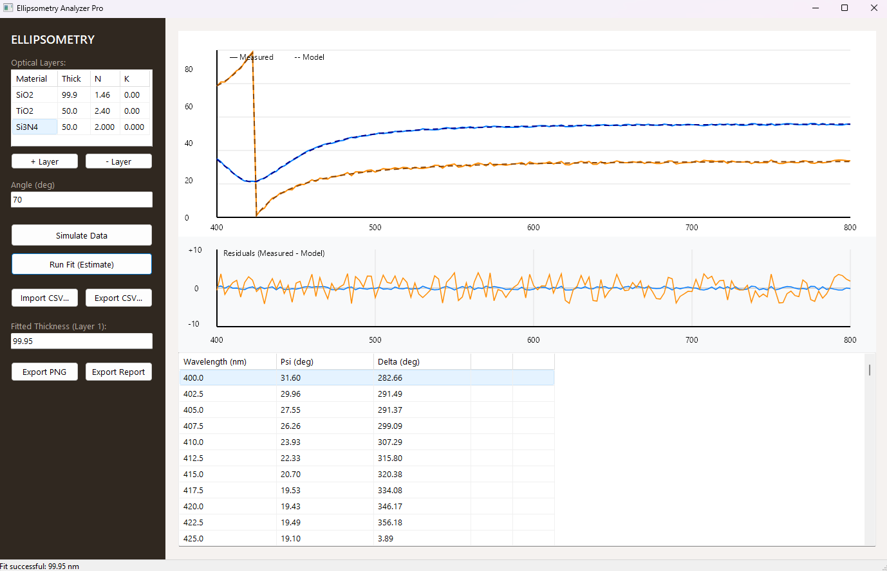

# Delphi Ellipsometry Analyzer


> **Scientific Disclaimer**  
> This project is a **portfolio prototype**, not instrument-grade software. The optical model uses illustrative constants and a simplified formulation based on the Transfer Matrix Method (TMM). Before using real measurements, validate Fresnel conventions, complex refractive-index dispersion, phase conventions, calibration, and the fitting algorithm against reference samples and instrument data.

---

## 📸 Main Window

<p align="center">
  
</p>

*The main interface: optical layer editor on the left, live $\Psi/\Delta$ spectrum on top, residual plot in the middle, and the raw data grid at the bottom.*

---

## 🎯 Overview

**Delphi Ellipsometry Analyzer** is a desktop application for **spectroscopic ellipsometry** that simulates, visualizes, and fits thin-film optical measurements. It is built with:

- **Delphi 12 Athens** (VCL)
- **Skia4Delphi** for high-performance vector charts
- **FireDAC + Firebird 5** for logging and project persistence
- **Transfer Matrix Method (TMM)** for physically correct multi-layer simulations
- **Nelder-Mead Simplex** for multi-parameter fitting

The application targets an $\text{Air} / \text{SiO}_2 / \text{Si}$ stack by default but supports arbitrary multi-layer configurations with user-defined materials, layer thicknesses, and complex refractive indices ($N, K$).

---

## ✨ Features

### 1. Measurement Workspace
- **CSV Import/Export**: Automatic delimiter detection (`,`, `;`, or tab) and invariant culture parsing (portable across locales via `FormatSettings.DecimalSeparator := '.'`).
- **Synthetic Data Generation**: Using the TMM engine with configurable Gaussian noise injection.
- **Data Grid**: Displays Wavelength ($\lambda$), $\Psi$, and $\Delta$ in real time.

### 2. Spectral Analysis (Skia Canvas)
- **Interactive Charts**: Mouse-wheel zoom and click-drag panning for detailed spectrum inspection.
- **Measured vs. Model Overlay**: Solid lines for experimental datasets, dashed curves for the fitted theoretical model.
- **Labeled Axes**: Wavelength ($\lambda$) in $\text{nm}$, $\Psi$ and $\Delta$ in degrees ($^\circ$).
- **Residual Plot**: Real-time display of the difference between measured and theoretical data points.

### 3. Optical Model Editor
- **Multi-Layer Support**: Add, remove, or reorder layers dynamically.
- **Material Library**: Pre-defined refractive index tables for standard materials ($\text{SiO}_2$, $\text{TiO}_2$, $\text{Si}_3\text{N}_4$, $\text{PMMA}$, $\text{Au}$, $\text{Ag}$, $\text{Si}$, $\text{Air}$).
- **Grid-ComboBox Integration**: In-place dropdown editor with automatic $N/K$ auto-fill upon selection.
- **Custom Materials**: Support for manual input of optical constants.

### 4. Parameter Fitting & Optimization
- **Single-Layer Estimation**: Coarse grid search combined with 40-step local boundary refinement.
- **Multi-Layer Estimation**: Nelder-Mead Simplex algorithm for simultaneous fitting of $N$ layers.
- **Live Residual Tracking**: Real-time chart updates after each iteration.
- **RMSE Analytics**: Root-Mean-Square Error reported in the status bar.

### 5. Export & Reporting
- **CSV Export**: Save raw or modified measurement arrays.
- **PNG Chart Export**: High-resolution image export of the Skia vector canvas.
- **Text Report**: Generated summary with final layer parameters, material indices, and fit statistics.

### 6. Firebird Logging Subsystem
- **FireDAC Integration**: Native connection to Firebird 5.0 database engines.
- **Fault-Tolerant Fallback**: Graceful fallback to a local text log file if the database engine is unreachable.
- **Audit Table**: `APP_LOG` stores timestamped event records for debugging and tracing.

---

## 🧱 Architecture

```
+-------------------------------------------------------------------+
|                            VCL UI Layer                           |
|  (UI.MainForm.pas, TStringGrid Editors, Skia Render Surfaces)    |
+---------------------------------+---------------------------------+
                                  |
                                  v
+---------------------------------+---------------------------------+
|                         Domain Logic                              |
|  (Domain.Types.pas: TOpticalModel, TOpticalLayer, TMeasurement)  |
+---------------------------------+---------------------------------+
                                  |
                 +----------------+----------------+
                 |                                 |
                 v                                 v
+---------------------------------+  +------------------------------+
|          Physics Engine         |  |      Optimization Fitter     |
|   (Physics.TMM.pas - Transfer   |  |   (Fitting.Simplex.pas -    |
|       Matrix Calculations)      |  |     Nelder-Mead Fitter)      |
+---------------------------------+  +------------------------------+
                 |                                 |
                 +----------------+----------------+
                                  |
                                  v
+---------------------------------+---------------------------------+
|                       Persistence Layer                           |
|       (FireDAC + Firebird 5 DB Audit Logging / File Fallback)     |
+-------------------------------------------------------------------+
```

---

## 🗄️ Database Schema

The audit logging subsystem targets a Firebird 5 database table (`APP_LOG`):

```sql
CREATE TABLE APP_LOG (
    LOG_ID       INTEGER GENERATED BY DEFAULT AS IDENTITY PRIMARY KEY,
    LOG_TIME     TIMESTAMP DEFAULT CURRENT_TIMESTAMP NOT NULL,
    LOG_LEVEL    VARCHAR(10) NOT NULL,
    MESSAGE      VARCHAR(1000) NOT NULL,
    CONTEXT_DATA VARCHAR(2000)
);
```

---

## ⚙️ Getting Started

### Prerequisites
- **Embarcadero RAD Studio** (Delphi 12 Athens or 13 Florence).
- **Skia4Delphi** installed via GetIt Package Manager or added to project search path.
- **Firebird 5.0** (Client/Server or Embedded) for full database logging functionality.

### Building from Source

1. Clone the repository:
   ```bash
   git clone https://github.com/your-username/delphi-ellipsometry-analyzer.git
   ```

2. Open `EllipsometryAnalyzer.dproj` in RAD Studio.

3. Verify that the **Skia4Delphi** packages are enabled for your target platform.

4. Build and run the project (`Ctrl + Shift + F9`).

---

## 🧪 Unit Testing

The repository includes a DUnitX test project to validate physical calculations and invariants.

1. Open `EllipsometryAnalyzerTests.dproj` in RAD Studio.
2. Verify that `Domain.Types.pas` and `Physics.TMM.pas` are added to the search path.
3. Run the test suite (`F9`).

### Sample Console Output

```
Executing Tests...
  [PASSED] Test_SingleLayer_SiO2_Thickness100nm_RefValues
  [PASSED] Test_SubstrateOnly_ZeroThickness
  [PASSED] Test_Angle_Effects
  [PASSED] Test_Wavelength_Calculations (Red Light - 632.8nm)
  [PASSED] Test_Wavelength_Calculations (Blue Light - 450.0nm)
  [PASSED] Test_Wavelength_Calculations (Near IR - 900.0nm)
  [PASSED] Test_Physical_Bounds

Done testing. 7 Tests Passed, 0 Failed, 0 Leaked.
```

---

## 🔬 Scientific Notes

### Transfer Matrix Method (TMM)

The optical response of a multi-layer stack is computed by multiplying the characteristic matrix $M_i$ of each layer:

$$
M = \prod_{i=1}^{N} M_i
$$

where each $M_i$ encodes the phase thickness $\delta_i$ and Fresnel reflection coefficients of layer $i$. $\Psi$ and $\Delta$ are derived from the complex reflection ratio $\rho$:

$$
\rho = \frac{r_p}{r_s}, \quad \tan \Psi = |\rho|, \quad \Delta = \arg(\rho)
$$

### Parameter Fitting

- **Single-Layer**: Coarse grid (300 points by default) + 40-step local refinement.
- **Multi-Layer**: Nelder-Mead Simplex with standard coefficients ($\alpha=1$, $\gamma=2$, $\rho=0.5$, $\sigma=0.5$).
- **Error Metric**:

$$
E = \sum_{j=1}^{K} \left[ (\Psi_{\text{calc}, j} - \Psi_{\text{meas}, j})^2 + \frac{(\Delta_{\text{calc}, j} - \Delta_{\text{meas}, j})^2}{100} \right]
$$

---

## ⚠️ Limitations

- Optical constants are fixed per material (no dispersion model yet).
- The default substrate is silicon with static optical constants.
- The multi-layer fitter requires a realistic starting initial guess to converge.

---

## 📄 License

Distributed under the MIT License. See `LICENSE` for details.

---

## 📬 Contact & Acknowledgments

- **Embarcadero Technologies** for Delphi 12 Athens and the VCL framework.
- **Skia4Delphi Maintainers** for the high-performance GPU canvas library.
- **Firebird Foundation** for the open-source relational database.
- **Ellipsometry Community** for theoretical reference formulas and conventions.